# Stå på!

En intern nettside for kontoret til [The Brave](https://thebrave.no), der vi 17 kollegaer konkurrerer om hvem som står mest ved ståpulten. Du velger en runde på 15, 30, 60 eller 90 minutter, eller sier at du skal stå til et bestemt klokkeslett. Alle ser det samme lille pikselkontoret, med hvem som står og hvem som sitter.

Jeg ville ikke lage en treningsapp. Jeg ville lage noe kollegaene mine syntes var gøy å åpne.

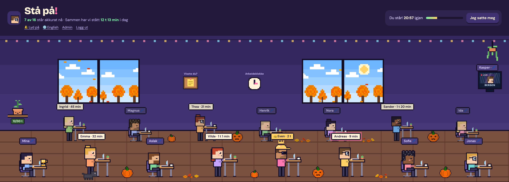

## Hva den gjør

- **Ståøkter.** Velg 15, 30, 60 eller 90 minutter, eller «Stå til …» et klokkeslett. Når runden er over, kommer det et pling, et varsel i nettleseren og spørsmålet «Står du fortsatt?». Du har fem minutter på deg til å svare. Svarer du ikke, avsluttes økta der runden sluttet, så de fem minuttene telles ikke med.
- **Rommet.** Alle ser det samme kontoret, og det oppdateres hvert femte sekund. Antall pulter og rader regnes ut fra hvor mange som jobber der, med ni pulter per rad på PC og fire på mobil.
- **Ledertavler** for i dag og for denne uka. Dagene og ukene regnes i norsk tid, ikke i tidssonen til serveren.
- **Heiarop.** Trykk på en kollega og send 👏🔥💪☕, eller send et ⬆️ «reis deg!» til en som sitter. Emojien dukker opp over hodet deres for alle som har siden oppe.
- **Kontorplanten.** En plante vi har sammen. Den vokser jo mer hele kontoret står i løpet av uka, og blomstrer når vi når 30 timer. På mandag starter den på nytt.
- **Oppslagstavla.** Dagens fakta om ståing, den samme for alle fram til midnatt. Hvert faktum skal komme fra en studie, en forskningsoversikt eller en helsemyndighet, og kilden står under. Det gjelder også når forskningen er mindre positiv enn man skulle håpe.
- **Været i vinduene.** Været ved kontoret hentes fra MET (Yr) og tegnes i vinduene: skyer, tåke, regn, snø, torden og vind. Himmelen følger klokka, fra soloppgang til natt.
- **Kontorhunden.** Hver dag rusler en av hundene til kollegaene over gulvet. Alle ser den samme hunden den dagen.
- **Skjerm på veggen** for de som jobber fra et annet sted. Shobhit sitter i Bergen, så han henger på veggen som en liten TV med regn bak seg.
- **Figurbygger.** Alle har sin egen pikselfigur med hår, skjegg, briller og noe på pulten. Egne tegninger, som luer og katter, kan lages i Piskel eller Aseprite og legges inn med `npm run sprites`.
- **Norsk eller engelsk.** Siden er på norsk, men bytter til engelsk hvis nettleseren er på engelsk. Du kan også bytte selv med 🌐-knappen.
- **Innlogging med Google**, bare for `@thebrave.no`-adresser.

## Bilder

Bildene er tatt med testdataene i `lib/demo-office.ts`, ikke med ekte ståtider.

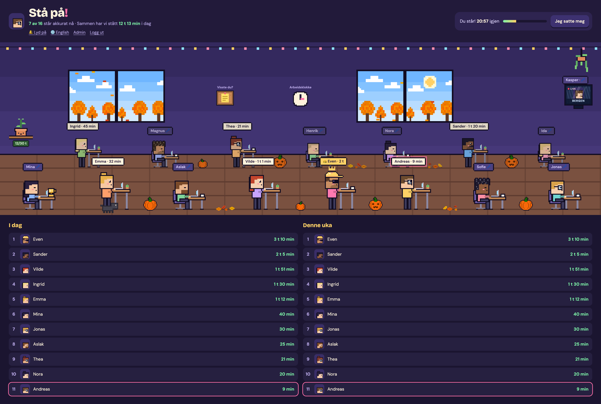

### Vinduene

Himmelen følger klokka, og været kommer fra MET. Om høsten står det trær utenfor, og bladene blåser forbi. Resten av året ser man byen.

| Sol | Soloppgang | Solnedgang | Natt |
| :---: | :---: | :---: | :---: |
| 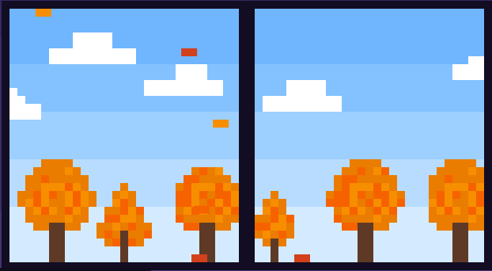 | 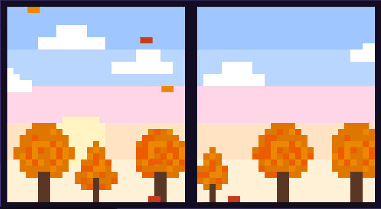 | 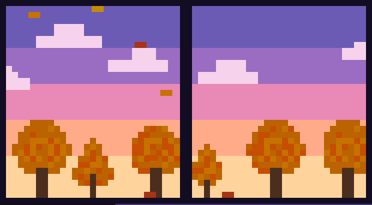 | 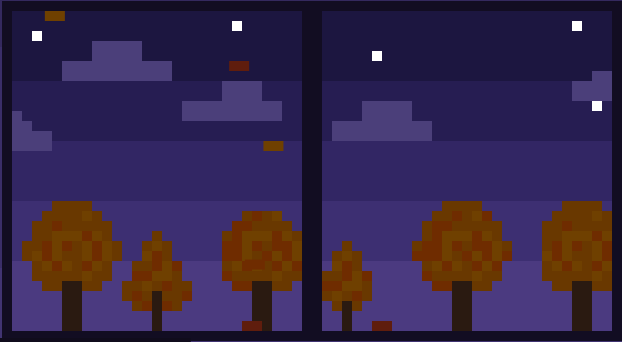 |
| **Regn** | **Kuling** | **Snø** | **Byen om sommeren** |
| 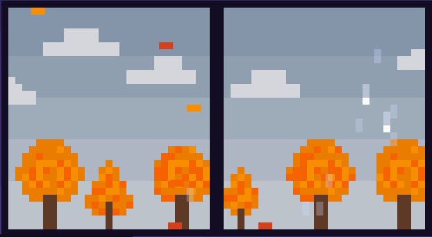 | 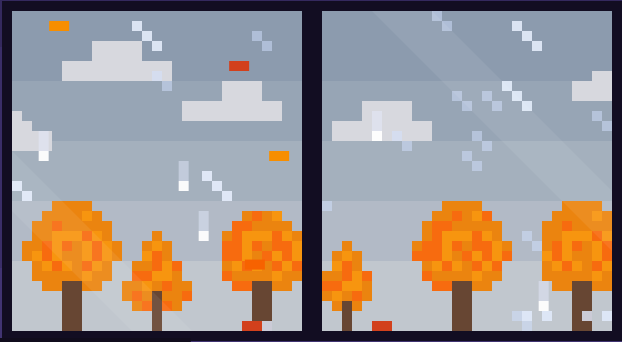 | 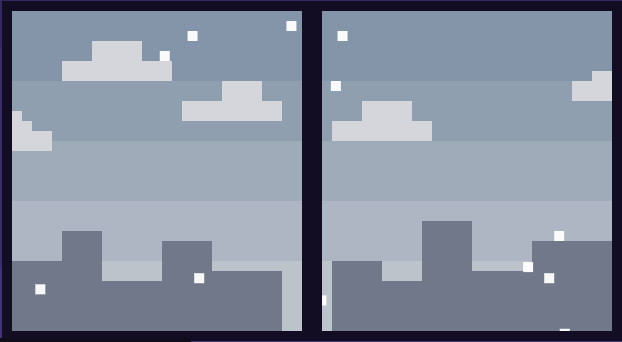 | 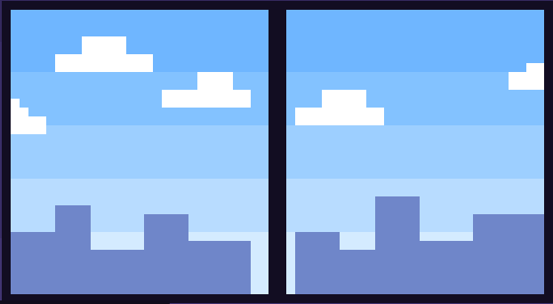 |

| Regn i sterk vind | Vindkast i høstbladene |
| :---: | :---: |
| 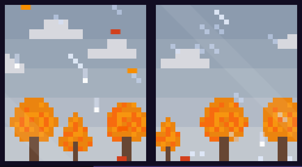 | 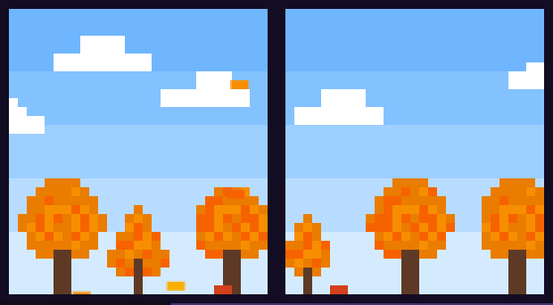 |

### Kveld og uvær

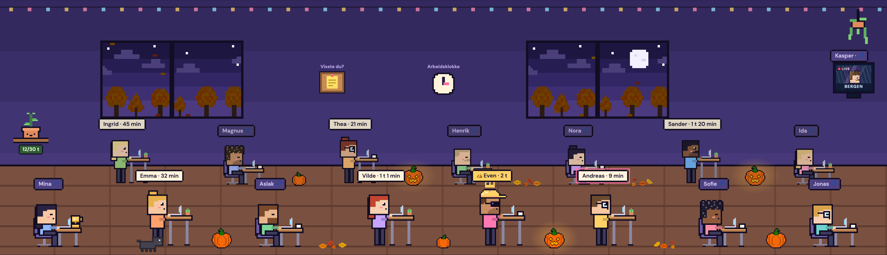

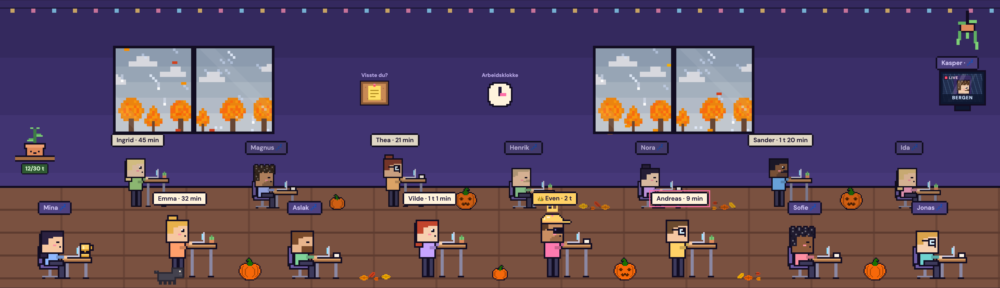

### Detaljer

| Heiarop | Et heiarop på vei | Oppslagstavla |
| :---: | :---: | :---: |
| 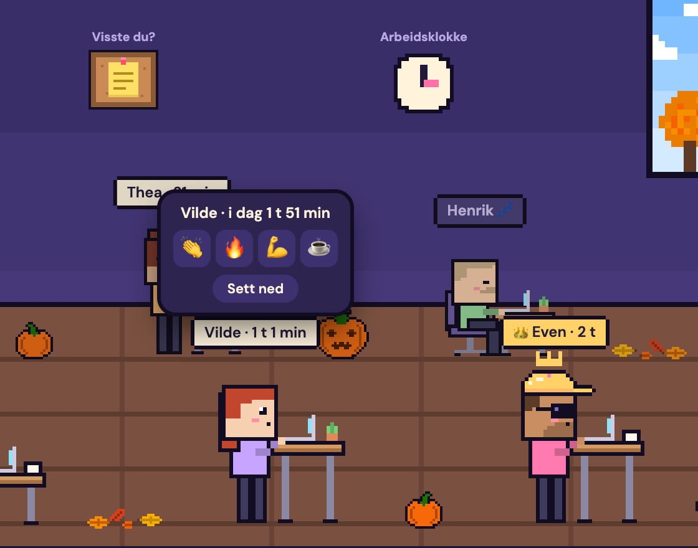 | 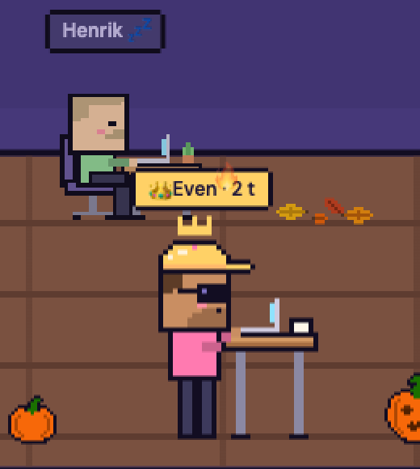 | 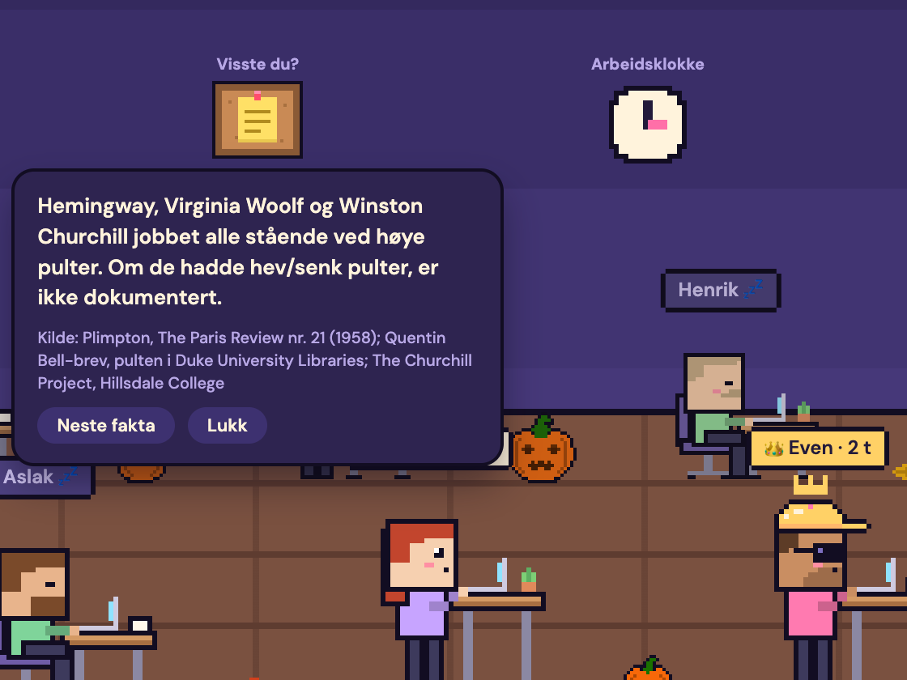 |
| **Kontorplanten** | **Skjermen på veggen** | **Stå til klokka** |
| 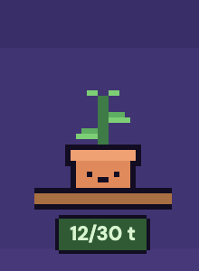 | 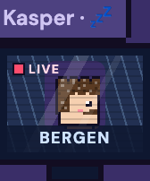 | 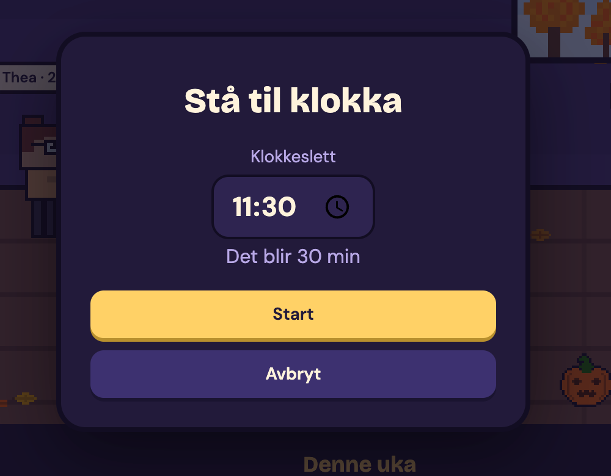 |

### Figurbyggeren

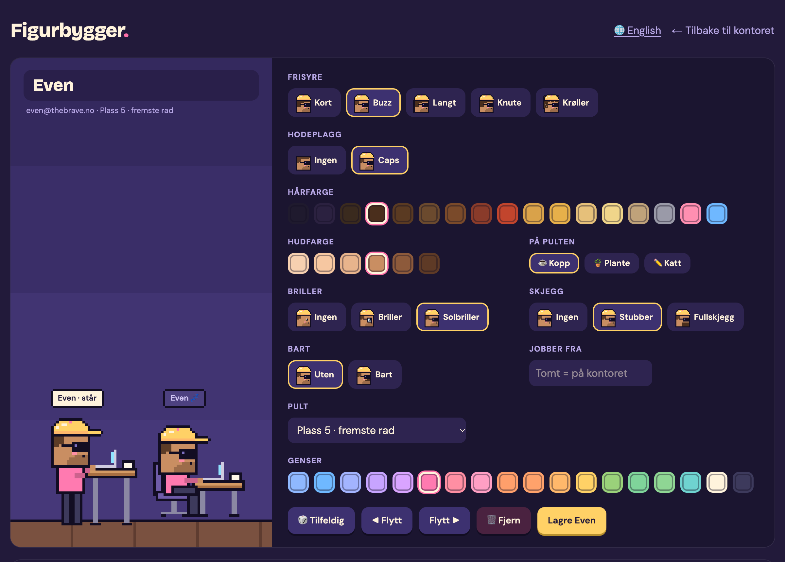

## Teknisk

Next.js 16 (App Router, Turbopack), React 19, TypeScript (strict), Auth.js v5, Neon Postgres med Drizzle, Vitest og CSS Modules.

Noen valg jeg har tatt, og hvorfor:

- **Reglene ligger i `lib/` som rene funksjoner, med tester ved siden av.** Runder, dager og uker, ledertavla, heiarop og plasseringen i rommet vet ingenting om databasen eller React. Laget mot databasen er tynt. Det er 225 tester, og de kjører på under ett sekund.
- **Ingen cron-jobb.** En runde som har gått ut, avsluttes neste gang noen henter data. Det er nok, og det er én ting mindre å drifte.
- **Norsk tid overalt.** Tid regnes i Europe/Oslo med `Intl.DateTimeFormat`, ikke ved å legge til et fast antall timer. Det er testet over overgangen til og fra sommertid.
- **Animasjonene har ingen egen tilstand.** Nedtellinger og bevegelser regnes ut fra serverens klokke når siden tegnes, så ingen `setState` i en effekt må holde takten.
- **Figurene er tegnet i kode.** Hver figur er en liste med `<rect>`-er på et rutenett på 40×48. Derfor kan de fargelegges og settes sammen fritt. En håndtegnet PNG kan gjøres om til de samme rektanglene med et skript.
- **Ingen middleware.** Innloggingen sjekkes på hver side, i hver route handler og inne i hver server action, fordi en server action kan kalles direkte med en POST.
- **Språkbytte uten cookies.** Serveren lager alltid siden på norsk, og nettleseren bytter språk etterpå. Da kan sidene caches, og serveren og nettleseren tegner aldri ulik tekst første gang.

## Kom i gang

```bash
cd standing-challenge
npm install
cp .env.example .env.local   # fyll inn Neon- og Google-variablene
npm run dev
```

Du kan se rommet uten database og innlogging:

```
http://localhost:3000/dev/room          # kontoret med testdata
http://localhost:3000/dev/room?hour=21  # kveldshimmel i vinduene
http://localhost:3000/dev/room?cheer=1  # et heiarop i lufta
```

| Kommando | Hva den gjør |
| --- | --- |
| `npm run dev` | Starter utviklingsserveren |
| `npm test` | Kjører testene (Vitest) |
| `npm run build` | Bygger for produksjon |
| `npm run sprites` | Gjør håndtegnede PNG-er i `sprites/` om til pikselrektangler |
| `npm run db:push:prod` | Oppdaterer databasen etter skjemaet i `db/schema.ts` |

## Struktur

```
standing-challenge/
├── app/            # sider, route handlers og server actions
├── components/     # rommet, figurene, ledertavla, admin
├── lib/            # logikken, med tester ved siden av
├── db/             # Drizzle-skjema og klient
├── locales/        # nb.json og en.json
└── sprites/        # håndtegnede PNG-er og maler
```

## Status

Kollegaene bruker appen hver dag. Den ligger på Vercel, databasen står i London, og hver push til `master` gir en ny versjon i produksjon.
