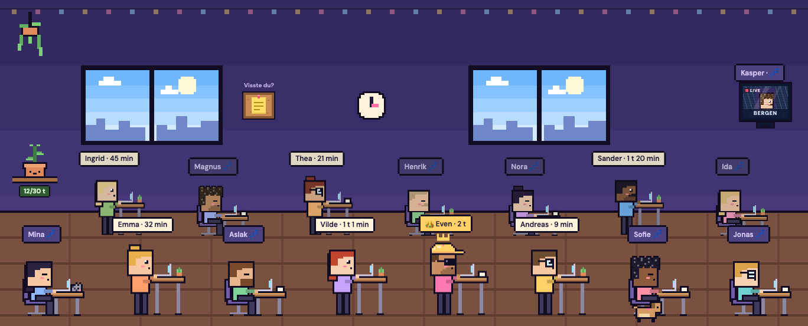

# Stå på!

Et internt nettsted for kontoret til [The Brave](https://thebrave.no), der vi 17 kollegaene konkurrerer om hvem som står mest ved ståpulten. Du velger 30, 60 eller 90 minutter, og alle ser et levende pikselkontor: hvem som står ved hevet pult, og hvem som døser ved en senket.

Målet var aldri å lage en treningsapp. Det var å lage noe kollegaene mine åpner og tenker «herregud så gøy og koselig».



## Hva det gjør

- **Ståøkter.** Velg 30/60/90 min. Når runden er over spretter «Står du fortsatt?» opp med pling og varsel i nettleseren, og du har fem minutters nådetid til å svare. Svarer du ikke, lukkes økta ved rundens slutt — nådetiden teller aldri.
- **Levende rom.** Alle ser det samme kontoret, oppdatert hvert femte sekund. Rommet følger kontoret: antall pulter og rader regnes ut fra hvor mange som sitter der, ni per rad på desktop og fire på mobil.
- **Ledertavler** for i dag og denne uka, regnet i Europe/Oslo — ikke i serverens tidssone.
- **Heiarop.** Trykk på en kollega og send 👏🔥💪☕, eller et ⬆️ «reis deg!» til noen som sitter. Emojien flyter opp over hodet deres hos alle som ser på.
- **Kontorplanten.** En felles ukesplante som vokser gjennom seks stadier mot 30 timer ståing for hele kontoret, og blomstrer når målet nås.
- **Oppslagstavla.** Dagens fun fact om ståing, lik for hele kontoret til midnatt. Husregel: hver eneste påstand skal kunne spores til en studie, en systematisk oversikt eller en helsemyndighet, og kilden står under teksten — også når forskningen sier noe mindre flatterende enn man skulle ønske.
- **Veggskjerm** for kollegaer som jobber et annet sted. Shobhit sitter i Bergen, så han henger på veggen som en pikselfjernsyn med regn bak seg.
- **Figurbygger.** Hver kollega får en pikselfigur med hår, skjegg, briller og pultgjenstander. Egne håndtegnede sprites (luer, katter, kopper) tegnes i Piskel eller Aseprite og bygges inn med `npm run sprites`.
- **Norsk som standard**, engelsk automatisk for engelske nettlesere eller via 🌐-knappen.
- **Google-innlogging** låst til `@thebrave.no`.

## Teknisk

Next.js 16 (App Router, Turbopack) · React 19 · TypeScript i strict · Auth.js v5 · Neon Postgres med Drizzle · Vitest · CSS Modules.

Noen valg som er verdt å forklare:

- **All regel-logikk ligger i `lib/` som rene funksjoner med tester ved siden av.** Runder, døgn- og ukegrenser, ledertavle, heiarop-regler og romutregning kjenner verken database eller React. Databasen-laget er tynt og uten egen logikk. 155 tester kjører på under ett sekund.
- **Ingen cron.** Utløpte runder lukkes dovent ved første lesning etterpå. Det holder, og det er én bevegelig del mindre.
- **Tid regnes i Europe/Oslo** med `Intl.DateTimeFormat`, ikke med faste timesforskyvninger — testet over sommertidsovergangene begge veier.
- **Ingen tilstand for animasjoner.** Timere og bevegelser utledes av `now` fra serveren i render, så det finnes ingen `setState` i en effekt som skal holde takten.
- **Pikselkunsten er `<rect>`-lister** på et 40×48-rutenett med `shape-rendering: crispEdges`, ikke bildefiler. Derfor kan figurene fargelegges, skaleres og settes sammen i kode — og en håndtegnet PNG kan konverteres til de samme rektanglene av et byggeskript.
- **Ingen middleware.** Innlogging sjekkes i hver side, hvert route handler og inne i hver server action, siden en server action kan treffes med en rå POST.
- **Språk uten informasjonskapsler.** Serveren rendrer alltid norsk, og klienten bytter etter mount. Det gjør sidene hurtigbufrbare og gjør en hydration-mismatch umulig ved konstruksjon.

## Kom i gang

```bash
cd standing-challenge
npm install
cp .env.example .env.local   # fyll inn Neon- og Google-variablene
npm run dev
```

Uten database og innlogging kan du fortsatt se rommet:

```
http://localhost:3000/dev/room          # kontoret med demodata
http://localhost:3000/dev/room?hour=21  # kveldshimmel i vinduene
http://localhost:3000/dev/room?cheer=1  # et heiarop i lufta
```

| Kommando | Hva den gjør |
| --- | --- |
| `npm run dev` | Utviklingsserver |
| `npm test` | Vitest |
| `npm run build` | Produksjonsbygg |
| `npm run sprites` | Bygger håndtegnede PNG-er i `sprites/` om til pikselrektangler |
| `npm run db:push:prod` | Sender skjemaet i `db/schema.ts` til databasen |

## Struktur

```
standing-challenge/
├── app/            # sider, route handlers og server actions
├── components/     # rommet, figurene, ledertavla, admin
├── lib/            # ren logikk med tester ved siden av
├── db/             # Drizzle-skjema og klient
├── locales/        # nb.json og en.json
└── sprites/        # håndtegnede PNG-er + maler
```

## Status

Appen er i daglig bruk på kontoret. Den ligger på Vercel med databasen i London, og hver push til `master` gir en ny produksjonsversjon.
